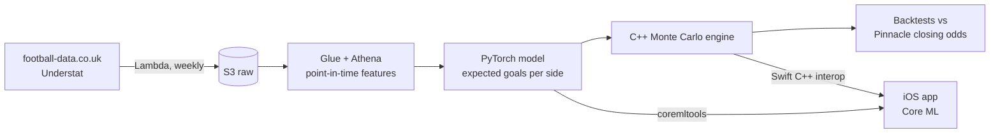

# Subspot

**Premier League match forecasts that grade themselves against the market.**

Subspot is an iOS app that forecasts every Premier League match. A machine learning model estimates
each side's scoring rate, a multithreaded C++ engine simulates the match thousands of times, and the
app shows full probability distributions: win/draw/loss, scorelines, and season outcomes. Every
forecast is scored against the bookmaker closing line, the sharpest public estimate there is, and
the results are published in-app.

[](https://github.com/kymanirjarrett/subspot/actions/workflows/engine.yml)
[](https://github.com/kymanirjarrett/subspot/actions/workflows/ml.yml)
[](https://github.com/kymanirjarrett/subspot/actions/workflows/ios.yml)

> 🚧 **Status:** early development. The C++ simulation engine and the Poisson baseline are
> working and tested; the PyTorch model and the iOS app are next. See the [roadmap](#roadmap).

## How it works



One C++ engine runs in two places: in Python through pybind11 for backtesting, and inside the iOS
app for instant on-device "what if" simulation. The numbers you see in the app come from the same
code that was evaluated.

## Repository layout

| Path | What lives there | Stack |
| --- | --- | --- |
| [`engine/`](engine) | Match simulation engine and its tests | C++20, CMake, GoogleTest, pybind11 |
| [`ml/`](ml) | Data loading, team canonicalization, models, evaluation | Python, pandas, SciPy, PyTorch (soon) |
| [`ios/`](ios) | `SubspotKit` domain package, then the SwiftUI app | Swift, SwiftUI, Core ML |
| [`infra/`](infra) | AWS resources as code | CloudFormation |
| [`docs/`](docs) | Architecture and design decisions | |

## Getting started

```bash
# C++ engine
cmake -S engine -B engine/build -DCMAKE_BUILD_TYPE=Release
cmake --build engine/build -j
ctest --test-dir engine/build --output-on-failure

# Python
python -m venv .venv && source .venv/bin/activate
pip install -e "ml[dev]"
pytest ml

# Swift (macOS)
cd ios/SubspotKit && swift test

# Git hooks (formatting, linting, secret detection)
pip install pre-commit && pre-commit install
```

## Roadmap

- [x] C++ Monte Carlo engine, tested against closed-form Poisson
- [x] Team name canonicalization across data sources
- [x] Poisson attack/defence baseline with log loss and Brier score
- [ ] **Phase 1:** Dixon-Coles baseline and walk-forward backtest vs Pinnacle closing odds
- [ ] **Phase 2:** Game-state effects in the engine (trailing teams push, leading teams sit deeper)
- [ ] **Phase 3:** PyTorch model with learned team embeddings that beats the baseline
- [ ] **Phase 4:** iOS app with Core ML, on-device simulation, season simulator, TestFlight
- [ ] AWS pipeline: Lambda ingestion, Glue/Athena features, Step Functions weekly retrain

## Data

- Results and bookmaker odds: [football-data.co.uk](https://www.football-data.co.uk/)
- Expected goals: [Understat](https://understat.com/)

## Disclaimer

Subspot is a forecasting and analytics project. It does not offer betting advice or facilitate
wagering.

## License

[MIT](LICENSE)
